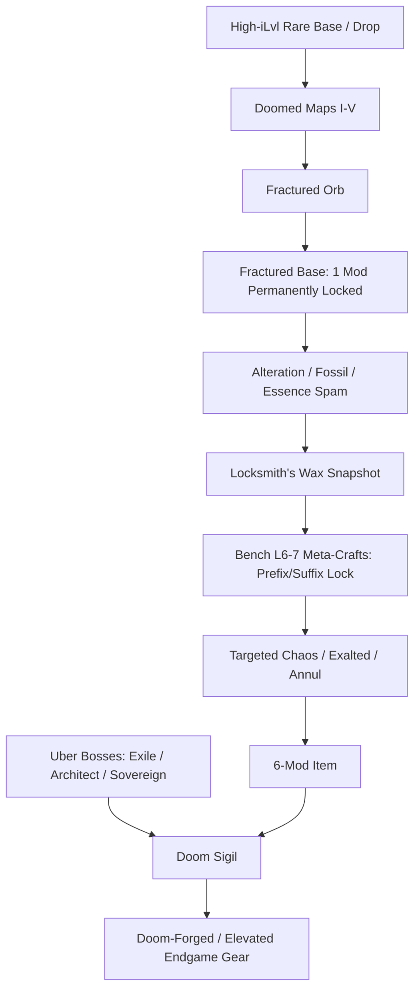
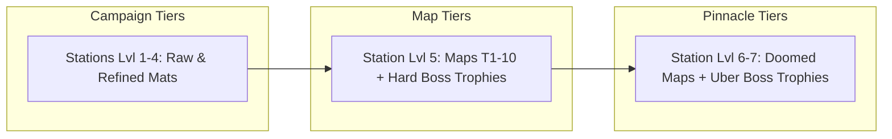

# Post-campaign crafting and hideout progression

Design specification and implementation plan for Milestone 10.
Last updated 2026-11-06.

---

## 1. Vision and Goals

Claudle of Exile's campaign (Acts 1–6) introduces foundational crafting: currency orbs, life-skill materials (Fossils, Essences, Resins), Contraband protection (Forger's Seals, Locksmith's Wax), Expedition Honing (Ancient Whetstones), Rune-carving, and the Crafting Bench through level 5.

Once a character enters Maps (T1–T10, levels 66–84), Doomed Maps (I–V, levels 86–94), and Hard/Uber Boss encounters (levels 72–96), gear demands change:
1. **From improvisation to deliberate engineering:** Players shift from rolling usable items with 1–2 desired modifiers to constructing multi-affix endgame pieces with protected steps and targeted locks.
2. **Deterministic safety for idle play:** High-end crafting in an idle game must never require fragile, unmonitored clicking. Automation, meta-locks, and impression snapshots must prevent bricking valuable items.
3. **Hideout as an endgame sink:** Campaign hideout upgrades currently cap at levels 4–7 using campaign materials (Mithril bars, Yew planks, Rough Gems, and Act boss trophies). Post-campaign play needs rewarding progression sinks that consume map loot, pinnacle trophies, and high-tier currency.

---

## 2. Current Baseline (Where Systems Stand Today)

### Crafting inventory and mechanics
- **Currency orbs:** Transmutation, Augmentation, Alteration, Regal, Alchemy, Chaos, Exalted, Annulment, Scouring, Divine (`src/engine/crafting.ts`).
- **Life-skill crafting:**
  - *Fossils (Mining):* Scorched, Frigid, Metallic, Dense, Serrated (bias/block mod groups during orb or smithing crafts).
  - *Essences (Harvesting/Alchemy):* Lesser & Greater (Vitality, Embers, Frost, Storm, Haste) force 1 specific mod onto Normal/Magic gear.
  - *Resins (Woodcutting):* Ash (+2) and Oak (+4) raise smithed base item levels.
  - *Shards:* Gathering yields Transmutation, Augmentation, and Alteration shards (20 fuse into 1 orb).
- **Protection and honing:**
  - *Forger's Seal (Heist contraband):* Protects 1 chosen modifier during Alteration, Chaos, Annulment, or Divine craft.
  - *Locksmith's Wax (Heist contraband):* Saves a 1-use impression of an item's modifiers, allowing full rollback.
  - *Ancient Whetstone (Expedition):* Upgrades 1 eligible modifier to the next tier (capped by item level; maximum 1 honed modifier per item).
- **Runes (Act 3 Rune-carving):** 1 carved rune per item, read differently by slot (Weapon, Armour, Jewellery). Unaffected by orbs.
- **Crafting Bench:**
  - Level 1: Unbuilt.
  - Level 2: Salvage enabled; Life & Resistance recipes.
  - Level 3: Stat/utility crafts; automatic gear-set switching on activity change.
  - Level 4: Top-tier standard crafts (Crit, Multi, Elemental).
  - Level 5: Auto-crafting activity (`src/engine/craftUntil.ts`) spending orbs/essences offline or live.

### Current hideout stations
All stations reside in `src/data/hideout.ts`:
- **Map Device (Levels 1–4):** +35% Item Rarity, +1 drop ilvl, up to 3 Sextant slots.
- **Stash (Levels 1–4):** 3 initial pages + 3 upgrade pages (6 free pages total; additional pages cost escalating Gold).
- **Forge (Levels 1–4):** Unlocks Copper, Iron, Mithril bases; Masterwork (+5 smithed ilvl).
- **Alchemy Table (Levels 1–4):** Potion tiers 1–3; 20% double brew chance.
- **Crafting Bench (Levels 1–5):** 19 bench recipes, auto-switch, auto-crafting.
- **Town Market (Levels 1–4):** 4 to 8 wares per shop, restock interval down to 4 minutes.
- **War Table (Levels 1–7):** Unlocks Status and Aim rules, 3rd rule slot, Normal/Magic/Rare auto-salvage.
- **Watchtower (Levels 1–4):** Extends offline progress cap from 8h to 12h, 16h, and 24h.

---

## 3. Post-Campaign Crafting Systems (Top-End Crafting)

### A. Fractured Items and Fractured Orbs
- **Source:**
  - Doomed Maps I–V (monster level 86–94).
  - Drop rates defined in `src/data/maps.ts` (`fracturedKill: 0.008`, `fracturedBoss: 0.25`).
- **Behavior:**
  - Can be applied to a Rare non-unique item with at least 4 modifiers.
  - **Random modifier pick (Settled decision):** The orb randomly selects 1 existing modifier to turn **Fractured** (golden border/tag). Forger's Seals cannot steer or protect this pick.
  - A Fractured modifier is permanent:
    - It cannot be removed or rerolled by Orb of Scouring, Alteration, Chaos, or Annulment.
    - An Orb of Scouring on a fractured item reduces it to a 1-mod Magic or Rare item holding only the fractured affix.
    - Fossils and Essences respect fractured affixes without overwriting them.
    - Limit: 1 fractured modifier per item.
- **Player impact:** Turns high-tier items found in Doomed Maps into safe, reliable foundations for multi-step crafting.

### B. Doom Sigils (Uber / Past-the-Limit Crafting Trinity)
- **Source:**
  - Dropped exclusively by the three Uber Bosses: The First Exile (~90), The Architect of Ruin (~93), and The Void Sovereign (~96).
- **Core concept:** "Past-the-limit" crafting that breaks standard modifier bounds without invalidating earlier gear.
- **The Three-Part Uber System (Settled decision: all three mechanics included):**
  1. **Exile's Doom Sigil (The First Exile, ~90):**
     - Elevates one existing Tier 1 modifier into an elevated **Doom Tier (Tier 0)** with an enhanced magnitude and unique bonus rider (e.g. T1 Flat Life +100 becomes Doom Life +125 and +2% maximum Life).
     - Limit: Exactly 1 Doom-Forged T0 modifier per item.
  2. **Architect's Doom Sigil (The Architect of Ruin, ~93):**
     - Imbues the item with a powerful **Doom Implicit**, replacing or augmenting the item's baseline implicit with boss-tier mechanics (e.g. "+1 to All Skill Gems", "20% of Physical Damage Taken as Chaos", "Hits Ignore Enemy Elemental Resistances").
     - Limit: 1 Doom Implicit per item.
  3. **Sovereign's Doom Sigil (The Void Sovereign, ~96):**
     - Shatters standard affix limits to open a **7th Modifier Slot (Void Slot)**, allowing the item to hold an extra modifier rolled from a dedicated Void affix pool.
     - Limit: 1 Void Slot per item.
- **Acceptance criteria:** Doom Sigils are rare, high-stakes pinnacle rewards that expand endgame build-crafting without bricking or destroying base items.

### C. Pinnacle Hard-Boss Materials
Each of the five Milestone 9 Hard Bosses drops an exclusive material:
- **Ossuar (~72):** Marrow Shards
- **Mother Vael (~75):** Choir Glass
- **The Undertow (~78):** Black Pearl
- **Twin Regents (~82):** Throne Ash
- **The Crownless (~86):** Crownless Sigil

**Uses:**
1. **Key Assembly:** 4 Marrow Shards, Choir Glasses, Black Pearls, and Throne Ashes can be combined at the Crafting Bench to forge a **Joined Key** for The Crownless.
2. **Boss Bench Enchantments:** Unlocks high-tier, specialized bench crafts (e.g. Choir Glass enables "+1 to Level of all Lightning Spell Skill Gems"; Black Pearl enables "Attacks inflict Cold Exposure on hit").
3. **Station Upgrades:** Used in Hideout Station upgrades past level 4 (see Section 4).

### D. Endgame Bench Meta-Crafts (Bench Level 6 & 7)
Meta-crafts allow players to isolate prefixes or suffixes during orb crafting:

| Recipe | Bench Lvl | Cost | Effect |
|---|---|---|---|
| **Lock Prefixes** | 6 | 2 Divine Orbs + 500 Arcane Dust | "Prefixes Cannot Be Changed" (crafted suffix). Scour/Chaos/Annul/Reroll cannot alter or remove prefixes. |
| **Lock Suffixes** | 6 | 2 Divine Orbs + 500 Arcane Dust | "Suffixes Cannot Be Changed" (crafted prefix). Scour/Chaos/Annul/Reroll cannot alter or remove suffixes. |
| **Multicraft** | 6 | 2 Exalted Orbs + 400 Arcane Dust | "Can have up to 3 Crafted Modifiers" (replaces the standard 1-crafted-mod limit). |
| **Mod Isolation: Attack** | 7 | 1 Divine Orb + 1 Throne Ash | "Cannot roll Attack Modifiers". |
| **Mod Isolation: Caster** | 7 | 1 Divine Orb + 1 Choir Glass | "Cannot roll Caster Modifiers". |

### E. Enhanced Auto-Crafting (Integration with Seals and Goals)
Auto-crafting (`src/engine/craftUntil.ts`) currently loops orbs or essences until a single target affix appears. Post-campaign upgrades extend this:
1. **Seal Integration:** Allow auto-crafting runs to lock an existing modifier with a Forger's Seal per step if the player has seals in the bank.
2. **Multi-Condition Targets:**
   - "Stop when Item has [Tier 1 Life] AND [Any Tier 1-2 Elemental Resistance]".
   - "Stop when Item has open Prefix AND 2+ desired affixes".
3. **Safety Caps:** Player-configurable stop limits on currency spent (e.g. "Stop after 50 Chaos Orbs or when condition is met").

---

## 4. Post-Campaign Hideout Progression

Hideout station levels expand into maps and pinnacle tiers, unlocking quality-of-life, automation, and stat caps.

### Station Cap Expansions

#### 1. Map Device
- **Level 4 (Current cap):** +35% Item Rarity, +1 drop ilvl, 3 Sextant slots.
- **Level 5 (Maps T7+ / Hard Bosses):**
  - *Cost:* 25,000 Gold, 20 Mithril Bars, 15 Rough Gems, 2 Marrow Shards, 2 Choir Glasses.
  - *Effect:* +50% Item Rarity, +2 drop ilvl, 4th Sextant slot unlocked permanently.
- **Level 6 (Doomed Maps / Pinnacle):**
  - *Cost:* 75,000 Gold, 1 Crownless Sigil, 2 Doom Sigils, 5 Divine Orbs.
  - *Effect:* "Pinnacle Conduit" — 15% chance for Map Bosses to drop an additional Map or Key; Sextant modifiers gain +2 base charges.

#### 2. Crafting Bench
- **Level 5 (Current cap):** Auto-crafting unlocked.
- **Level 6 (Maps T5+):**
  - *Cost:* 30,000 Gold, 1,500 Arcane Dust, 40 Mithril Bars, 3 Black Pearls, 3 Throne Ashes.
  - *Effect:* Unlocks Meta-crafting recipes (Prefix/Suffix locks, Multicraft); allows Forger's Seals to be assigned in Auto-crafting.
- **Level 7 (Uber Bosses):**
  - *Cost:* 100,000 Gold, 3,000 Arcane Dust, 1 Crownless Sigil, 2 Doom Sigils.
  - *Effect:* Unlocks Doom Sigil crafting, Caster/Attack isolation recipes, and multi-condition Auto-crafting.

#### 3. Stash
- **Baseline Feature (Act 1):** **Stash Affinities** are a baseline convenience from Act 1, not gated by late hideout upgrades. Players can tag stash tabs for automatic routing (Currency, Maps, Gems, Fragments, Gear) on quick-deposit.
- **Level 4 (Current cap):** 6 free pages + gold purchases.
- **Level 5 (Maps Organization):**
  - *Cost:* 20,000 Gold, 60 Yew Planks, 40 Mithril Bars, 5 Boss Trophies.
  - *Effect:* **Dedicated Map Storage Tab** — provides structured tier-by-tier slots (T1–T10 and Doomed I–V) with quantity badges, quick-run buttons, and auto-sorting.
- **Level 6 (Endgame Vault):**
  - *Cost:* 60,000 Gold, 100 Yew Planks, 80 Mithril Bars, 1 Crownless Sigil.
  - *Effect:* +2 free stash pages and **Currency & Fragment Overview Tab** with inline crafting access.

#### 4. Smithing Forge
- **Level 4 (Current cap):** Masterwork (+5 smithed base ilvl).
- **Level 5 (High-Tier Smithing):**
  - *Cost:* 35,000 Gold, 100 Mithril Bars, 50 Yew Planks, 4 Marrow Shards.
  - *Effect:* "Pinnacle Metallurgy" — smith bases up to item level 84 (Pinnacle base types: Astral Plate, Titanium Shield, Vaal Regalia equivalents); smithed bases have a 10% chance to roll with 1 random Tier 1 modifier pre-installed.

#### 5. Alchemy Table
- **Level 4 (Current cap):** 20% double brew chance.
- **Level 5 (Elixirs and Distillation):**
  - *Cost:* 35,000 Gold, 200 Voidbloom, 20 Rough Gems, 4 Choir Glasses.
  - *Effect:* Brew Instilling and Enkindling reagents; 3:1 orb conversion at the table (convert lower orbs into higher currencies at standard rates).

#### 6. Watchtower
- **Level 4 (Current cap):** 24 hours offline progress.
- **Level 5 (Endgame Vigil & Offline Mapping):**
  - *Cost:* 80,000 Gold, 300 Yew Planks, 300 Mithril Bars, 1 Crownless Sigil.
  - *Effect:* **Autonomous Offline Mapping** — allows automated Map Device progression offline. The character continues running maps from the shared realm supply up to a user-configured safe tier ceiling, with automatic safety halts if character life drops critically or bags fill up.

---

### New Station Proposal: The Trophy Altar (Hall of Relics)
- **Role:** Dedicated post-campaign monument station.
- **Unlock:** Built after defeating the first Milestone 9 Hard Boss.
- **Mechanic:** Displays earned Boss Trophies and Sigils (Ossuar, Vael, Undertow, Regents, Crownless, First Exile, Architect, Sovereign).
- **Perks:** Each placed trophy provides a permanent, account-wide minor perk:
  - *Ossuar's Plating:* +3% increased Armour and Evasion realm-wide.
  - *Vael's Hymn:* +5% increased Mana regeneration rate.
  - *Undertow's Pearl:* +5% chance for monsters to drop additional life-skill materials.
  - *Regents' Brand:* +4% all Elemental Resistances.
  - *Crownless Sigil:* +10% increased Map Boss drop rates.
  - *Doom Sigil:* +5% chance for dropped rare items in maps to roll with high-tier modifiers.

---

## 5. Economic Balance & Classic Mode

1. **Currency Sinks:**
   - Meta-crafts act as intentional sinks for Divine and Exalted Orbs, giving endgame wealth a direct, high-value sink outside the Player Market.
   - Gold sinks in hideout upgrades (20,000 to 100,000 Gold) create ongoing demand for selling excess map gear.
2. **Classic Mode Adaptation:**
   - In Classic Mode (where non-combat skills are disabled), life-skill material costs for hideout upgrades convert directly to Gold and Boss Trophies.
   - Bench recipes requiring life-skill items (e.g. Fossils, Essences) remain accessible via combat drops (which already drop contraband and boss materials).

---

## 6. Settled Design Decisions (2026-11-06)

The following core decisions have been settled:

1. **Fractured Orb Targeting (Settled: Random pick):**
   - Fractured Orbs randomly select one modifier from among all existing affixes on a 4+ mod rare item.
   - Forger's Seals cannot guarantee or steer which affix is fractured. This preserves classic high-stakes crafting risk.
2. **Doom Sigils (Settled: Complete three-part system):**
   - All three proposed endgame crafting mechanics are implemented, each bound to one of the three Uber Bosses:
     - The First Exile (~90) drops the **Exile's Doom Sigil** (Elevates one Tier 1 mod to **Tier 0 Doom Tier**).
     - The Architect of Ruin (~93) drops the **Architect's Doom Sigil** (Imbues an item with a **Doom Implicit**).
     - The Void Sovereign (~96) drops the **Void Sigil** (Unlocks a **7th Modifier Slot / Void Slot**).
   - An item can benefit from at most one of each Uber modification (1 T0 affix, 1 Doom Implicit, and 1 Void Slot).
3. **Stash Affinities (Settled: Baseline Act 1 feature):**
   - Stash tab affinities (Currency, Maps, Gems, Fragments, Gear) are a baseline UI convenience available from Act 1 upon unlocking the Stash.
   - Hideout upgrades provide dedicated specialized tabs (Map storage tab, Currency vault tab) and extra pages rather than holding back basic sorting.
4. **Offline Map Auto-Running (Settled: Supported):**
   - Auto-running maps offline is an intended feature of post-campaign progression.
   - Players can queue maps or configure a safe auto-run tier ceiling; offline simulation consumes maps from the shared realm pool and deposits rewards into the stash/haul within safe death/storage boundaries.
   - Watchtower Level 5 enhances offline mapping duration and safety buffers.

---

## 7. Suggested Implementation Milestones

- **Phase 1: Foundation (Milestone 10A)**
  - Implement Fractured Orbs in `src/engine/crafting.ts` and fractured items in `src/engine/items.ts`.
  - Add fractured item tooltips and styling.
  - Add basic Fractured drop verification.
- **Phase 2: Meta-Crafts & Bench L6 (Milestone 10B)**
  - Add Bench Level 6 to `src/data/hideout.ts`.
  - Implement "Prefixes Cannot Be Changed", "Suffixes Cannot Be Changed", and Multicraft in `src/engine/crafting.ts`.
  - Update `src/engine/craftUntil.ts` to respect meta-locks and Seals.
- **Phase 3: Endgame Hideout Station Upgrades (Milestone 10C)**
  - Expand Map Device, Stash, Forge, Alchemy Table, and Watchtower station levels.
  - Implement Stash Affinities in `src/engine/storage.ts` and stash UI.
- **Phase 4: Pinnacle Crafting & Doom Sigils (Milestone 10D)**
  - Implement Doom Sigil elevated crafting upon completion of Uber Bosses (Milestone 8/9).
  - Add Trophy Altar station and account-wide milestone perks.
